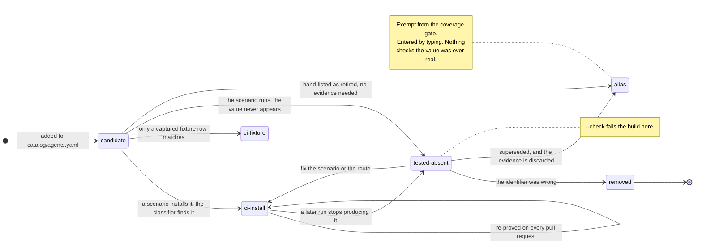

# Signature lifecycle v1 — what the tree does today

**This describes behaviour that exists.** Every rule here is enforced by code in this
repository right now. The successor design is `docs/signature-lifecycle-v2.md`, which is
**not built** — read this one to understand the tree, that one to understand where it is
going.

An identifier is a fact about one build of one product on one machine, and products change
theirs. This repo has been bitten twice:

- **`bot.molt.mac`** shipped for OpenClaw straight from the vendor's own Homebrew metadata and
  matched nothing on any Mac. The real id is `ai.openclaw.mac`.
- **`aider`** installs as `aider-chat` under `uv` and `pipx` while its state directory is
  `~/.aider`, so evidence and signature never met.

Both were silent and neither was caught by review. This is how the catalog is kept true.

## The lifecycle



Two things the diagram is drawing attention to. **`alias` is reachable directly from
`candidate`** — a value can be exempted from the gate by being typed into a `retired:` list,
with no evidence at any point. And **the edge into `alias` runs through `--allow-shrink`**,
which discards the observation that proved the identifier, so the evidence and the exemption
cannot both survive.

## A real install is the bar

A signature is verified when a CI scenario installs the real software and asserts the
classifier finds it. Coverage is counted **per identifier** — an agent can pass while carrying
an identifier nothing exercised — and only from scenarios in the `scenarios.yml` matrix, which
runs on every pull request. `tools/agent_status.py --check` fails the build below complete, so
there is no partial state to manage.

Each run records what it actually matched in `test/scenarios/<name>/observed.json`, beside the
scenario that wrote it, so a run changes one file and a reviewer reads the diff next to its
cause. A record holds the agent version, platform, OS and arch that produced the identifier.

## When something cannot be verified, say so

`tools/validate_catalog.py` refuses an agent that is neither covered by a scenario nor carrying
an exception:

```yaml
unverified:
  - identifier: {route: bundle_ids, value: com.example.enterprise-agent}
    reason: requires a paid licence and an interactive sign-in; no unattended install
    evidence: vendor-documentation
    raised: 2026-08-31
```

`evidence` grades what you actually have, weakest first:

| grade | meaning |
|---|---|
| `vendor-documentation` | what produced `bot.molt.mac`. Lowest trust |
| `registry-manifest` | the artifact resolves under that exact name from its registry |
| `artifact-metadata` | the artifact's own config confirms what it is — an image entrypoint, a bundle `Info.plist` |

There is deliberately no `real-install` grade: a real install needs no exception. The validator
also refuses a reason too short to be a reason, a date that is not a date, and a block on an
agent that *is* covered — in which case the block contradicts the scenario and one of them is
stale.

The exception is permitted and **reported on every regeneration** of `docs/agents.md`, so it
cannot quietly become permanent. **A catalog may carry a guess. It may not hide one.**

There is a second register at identifier level, `untested:`, carrying a reason and a `raised`
date for a value no CI test covers. `--gate` accepts it; `--check` does not, so it buys a
recorded reason rather than a green build. **Neither register has any entries** — both are
absent from `catalog/agents.yaml`, not merely empty.

## One route grades stronger than observation

A Chromium extension id is not assigned, it is **derived**: SHA-256 over the developer's DER
public key, first 16 bytes, hex mapped `0-f` to `a-p`. The Web Store's signed CRX carries that
key, so the id can be recomputed from the publisher's own signed artifact rather than observed
on a machine.

An observation says one machine reported an id once; a derivation says the id belongs to that
signing key and could not belong to anyone else's. It also explains exactly why a planted or
unpacked extension reports an **empty** identifier — no key, nothing to derive from.

Most routes offer nothing like it. A bundle id is a string in a plist anyone can write, an
image tag is chosen by whoever ran `docker tag`, and a Homebrew token is a name in a
repository. For those, a real install remains the bar.

## Several generations of one signature, all live at once

Nothing special happens for an older generation. It is an ordinary catalog value, indexed and
matched exactly like the current one. Three layers carry the version spread, each doing a
different job:

| layer | how it holds several generations | read it in |
|---|---|---|
| **catalog** | every generation is a normal value on its route. `retired:` labels the ones from an earlier release | `catalog/agents.yaml` |
| **assertion** | a `must_contain` entry may be a **list**, meaning *any of these satisfies the probe* — so a scenario passes on whichever generation the runner installs | `test/lib/assert.sh` |
| **coverage** | credit is keyed `(route, value)` and recorded per `(platform, os, arch)` with the `agent_version` that produced it, so two runners producing two generations both get recorded | `tools/agent_status.py` |

OpenClaw is the widest case in the tree: `moltbot` → `clawdbot` → `openclaw` on npm, and
`bot.molt.mac` → `ai.openclaw.mac` as a bundle id. All of them are in the index at the same
time; a machine reports whichever it has.

The alternation in `must_contain` was not a design, it was a **measurement**. One run installed
the same `chatgpt` cask on two runner images and got two builds — a current one reporting
`com.openai.codex`, and one whose Homebrew metadata was stale enough to still resolve the
pre-rename release, reporting `com.openai.chat`. A single-value probe would have gone red on
one runner and named the wrong cause.

**What the coexistence costs.** On the exact-match routes, an extra generation is one more dict
entry and no extra comparison. On the prefix and path routes it is one more comparison per
candidate row — `bot.molt.` is a `launchd_prefixes` value, so it is compared against every
daemon row on every host. That is the ceiling worth watching if a lineage grows long, and it is
a property of the route, not of the value being old.

## `retired` means two opposite things

The word appears in both catalogs with nearly inverted meanings. This is the trap most likely
to cost someone an afternoon:

| where | what it means | effect on matching |
|---|---|---|
| `catalog/routes.yaml`, on a **route** | the route no longer identifies anything. `ports` is the only one | the route **cannot claim** a row unless the process holding it already names the agent |
| `catalog/agents.yaml`, on an **agent** | these values are identifiers from an earlier release, kept for machines that still carry them | none. They match exactly like current values |

`bin/classify` reads the first (`registry.retired`, applied in the match loop) and **does not
read the second at all**. A reader who sees `registry.retired` in the matcher and concludes
that old identifiers get special handling has it backwards: the route flag *withholds* a match,
and the agent field does not reach the matcher.

## Does the classifier check the old identifiers?

**Yes — they are matched, and no, the output does not say so.**

- `build_index` indexes every value on every route, and an agent's `retired:` list is not
  consulted, so an older generation is matched on exactly the same terms as the current one.
- Because the list is not consulted, a finding on `com.openai.chat` and a finding on
  `com.openai.codex` render identically. The reader cannot tell *this Mac runs a current build*
  from *this Mac has a build old enough that its identifier changed* — which is the one fleet
  fact a match on an older generation uniquely carries.

**The invariant, and it governs the successor design too:** treating a signature as historic
must mean *no longer proved by a live CI install*. It must never mean *no longer matched*. A
historic set the matcher does not consult would stop detecting precisely the machines it exists
for, and it would do it silently — an empty result indistinguishable from a clean machine,
which is the one error this repo exists to avoid. Whatever marks an identifier as historic must
be a **label on the finding, never a filter on it**.

## What tells you a signature has drifted

Three things fire, at different moments, and they see different halves of the problem. All
three run on every pull request.

| trigger | when it fires | where |
|---|---|---|
| **the shrink guard** | a scenario run proves *fewer* identifiers than the committed record. Refuses to record and names each loss, the key it compared on, and the keys the file holds | `tools/agent_status.py`, in `record()` |
| **`tested-absent`** | a CI scenario asserts this agent and this identifier never showed up. `--check` fails the build | `tools/agent_status.py`, in `collect()` |
| **an assertion** | `must_contain` names the value and the row is gone. Fires *before* recording, so the job goes red without reaching the guard above | `test/lib/assert.sh` |

The order matters when reading a red suite: an assertion failure means the value was named
explicitly by a scenario, and the shrink guard means it was only being counted. A value under
an alternation list fires neither until the *last* alternative goes.

## The state that does the most work

`did not appear` — a CI scenario installed the agent and the identifier never showed up. It
means one of five things, and telling them apart is the work:

| it means | how you tell | what to do |
|---|---|---|
| the scenario installs by another route | another route's value appeared in the same run | install that route — on **another machine**, because two routes claiming one binary name cannot share a host |
| the artifact only exists once the agent **runs** | it is a `state_dirs` value and the scenario only installed | invoke the agent. A state directory is not created by installing |
| the identifier is **wrong** | **it has never appeared in any committed observation**, and a registry lookup names something else | remove it |
| the route cannot identify at all | it only ever matched when something else had already named the agent | remove the route. `ports` went for this |
| **the identifier is right and is no longer installable** | **it appeared in a committed observation before, and does not now** | keep it, on that agent's `retired:` list |

Both catalog bugs found so far surfaced through the wrong-identifier case, and neither survived
a registry lookup: npm `mcp` is Mintlify's package, and npm `aider` is a static-site component
by an unrelated maintainer. Each sat beside a comment explaining the discrepancy rather than
questioning it, which is how a guess survives review.

The discriminator between the third row and the last is one command, and it is the whole
triage:

```console
$ grep -rl '"value": "com.openai.chat"' test/scenarios/*/observed.json
test/scenarios/10-desktop-apps/observed.json

$ grep -rl '"value": "bot.molt.mac"' test/scenarios/*/observed.json
```

A value some run once produced is a fact with provenance behind it. A value nothing has ever
produced is a guess.

## Proving an old identifier

Do not conclude that an older generation is untestable. That conclusion was reached once, in
writing, and was wrong: OpenClaw's retired npm names were recorded as coverable only by a
fixture on the reasoning that nothing installs them any more, and both packages turned out to
be still published. `56-openclaw-retired-names` installs them for real.

Two things that scenario had to get right, and both generalise:

- **The old generation usually cannot share a host with the current one.** All three OpenClaw
  packages provide the same global binary, so npm would have them fight over it and one would
  mask another. Testing a lineage means one scenario per generation, not one scenario installing
  the lineage.
- **It installs deliberately outdated software**, which is safe only because the guest is
  disposable, unenrolled and holds no credentials. That warning belongs in the setup script,
  where someone reads it before running it — not in `expected.json`, where it is rendered into a
  coverage report nobody consults first.

## Two things only a real run exposed

**Credits are keyed by `(route, value)`, never by value alone.** OpenClaw ships an npm package
*and* a Homebrew cask both called `openclaw`, so a value-keyed credit let an npm-only scenario
record the Homebrew token as observed — a real install no row supported.

**Coverage counts against CI, not against "has anyone run this".** A scenario passing only on a
maintainer's machine catches nothing on a pull request, and one sat in exactly that state:
passing locally, absent from the matrix, indistinguishable from covered.

## What is automated today

Measurement and enforcement are automated end to end. Every decision and every catalog edit is
manual.

| automated, no human in the loop | where |
|---|---|
| recording what each scenario run matched, per identifier, with the agent version, platform, OS and arch that produced it | `--record`, in every scenario job |
| merging one scenario's observations across every runner in a run | the `collect` job, main-only |
| regenerating `docs/agents.md` and the README badge, committing when coverage moved | `--write`, plus `docs.yml` as a safety net for direct pushes |
| computing per-identifier and per-platform coverage against the CI matrix | `tools/agent_status.py` |
| refusing a run that proves less than the committed record, and naming every loss | the shrink guard |
| failing the build on an identifier no CI test covers | `--gate` and `--check`, both in `test/lint.sh` |
| failing an `untested:` entry whose identifier **is** now covered, so a reason cannot outlive the gap it excused | `--gate` |
| rejecting a `retired:` value that is not one of that agent's identifiers | `tools/validate_catalog.py` |
| failing prose whose numbers no longer match the tree | `tools/check_doc_numbers.py` |

| manual, a human decides and edits | why |
|---|---|
| triaging **why** an identifier stopped appearing | five causes, five different actions, and only two are separable from the record alone |
| adding a value to `retired:` | it is the claim "this belongs to an earlier release", and nothing in the tree derives it |
| writing an `untested:` or `unverified:` block | the evidence grade is a judgement about what you actually hold |
| passing `--allow-shrink` | it discards evidence, so it should cost a decision |
| removing a scenario from the CI matrix | nothing derives that coverage was intentionally dropped |
| widening an assertion to an alternation list | which generations a runner may produce is read off runs, not predicted |

## Where this version falls short

Four gaps. `docs/signature-lifecycle-v2.md` closes all four.

- **`retired:` is an assertion that excuses itself.** It exempts a value from the coverage gate,
  and nothing checks that the value was ever real. Of OpenClaw's four retired identifiers, the
  two npm names are backed by a real CI install and the two from the old `.app` are backed by
  nothing — no fixture, no scenario, no observation. They are the excluded aliases the gate
  reports, and they are the last hand-typed exemption in a repo whose rule is that nothing ships
  without a real test.
- **The only automated exit from a lost identifier discards the evidence.** `--allow-shrink`
  **replaces** the record for that `(platform, os, arch)` key, so the observation that proved the
  identifier is dropped in the same step that keeps the identifier.
- **No observation carries an age or a run identity.** A record holds the agent version,
  platform, OS and arch, and nothing that distinguishes a CI runner from a maintainer's Mac, or
  says when it was proved. Marker rows carry the scan time in `ver` and `bin/classify` computes
  staleness from it, but coverage records do not — so a freshness gate does not exist, and proof
  cannot outlive the scenario that produced it.
- **A scenario leaving the CI matrix silently drops coverage.** Coverage counts only scenarios
  currently in the matrix, while a scenario's `observed.json` is left in the tree when it leaves.
  Every scenario directory is in the matrix today, so nothing is in this state — but the moment
  one is dropped, its identifiers fall to the state meaning *observed, but never by CI*, and the
  record that would have justified them sits in the tree unread.
