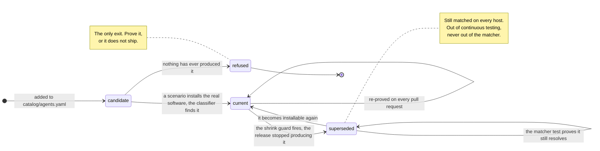

# Signature lifecycle v2 — the north star

**NOTHING HERE IS BUILT.** No code in this repository produces or reads any field, state or
file described below. It is a design record, and it is marked because a vocabulary term with no
producer is the `stale:<n>` mistake — documented in three places, emitted by nobody, and
accepted by a lint check for the whole time. Read `docs/signature-lifecycle-v1.md` for what the
tree actually does.

When this ships, this file describes behaviour and v1 is deleted.

## The rule

**A signature is admitted only if a CI scenario has proved it by a real install — now, or in
the past. There is no third way in.**

| state | what it means | how it is tested |
|---|---|---|
| **current** | the release CI installs today produces this identifier | a scenario, on every pull request |
| **superseded** | a scenario proved it, and the release CI installs today no longer produces it | the matcher test, on every pull request: the value still resolves to its agent |

A superseded signature leaves continuous testing and **stays in the matcher**. Nothing else is
admitted: a value no run has ever produced is not a signature, it is a guess with a comment
beside it, and the two are indistinguishable until something tries to install it.



Two properties the diagram is making explicit. **There is no edge from `candidate` to
`superseded`** — supersession requires a prior observation, so it cannot be reached by typing.
And **`refused` is the only terminal state**: v1's `alias`, `ci-fixture`, `local-only` and
`no-ci-platform` all disappear, because each was a way for a value to persist without a real
install behind it.

## Why `superseded`, and not `retired` or `archived`

The word is load-bearing, because the one thing a reader must not conclude is that these
signatures stop being matched. Industry vocabulary splits along a useful line:

| precedent | word | what it means there |
|---|---|---|
| CPE dictionary | `deprecated`, with a pointer to the replacement | an identifier for a renamed platform, kept because old scan data references it |
| MITRE ATT&CK | `deprecated`, and `revoked` where a specific successor exists | revoked carries the successor; deprecated does not |
| Sigma | `status: deprecated` / `unsupported` | plus a directory that deprecated rules move into |
| npm, PyPI | `deprecated` | still resolvable, still installable, marked |
| RFC, IANA | `Historic` | superseded, kept for the record |
| HTTP | `Deprecation`, then `Sunset` | advice, then an end date |

The common word is **deprecated**; where the point is that a specific newer thing took over, it
is **revoked** or **superseded**. This catalog is the second case, and three things decide it:

1. **It names what was measured.** `retired` and `archived` describe what *we* did.
   `superseded` describes what the *vendor* did — a newer identifier took over. That is the fact
   the record holds.
2. **It is silent about matching.** `archived` means "moved out of the active set" nearly
   everywhere, and `retired` reads as "no longer in service". Both invite the one misreading
   that would break the fleet. A superseded identifier is matched on every host, forever.
3. **`retired` is already taken, for the near-opposite meaning.** On a route in
   `catalog/routes.yaml` it means the route **cannot claim** a row. Reusing it for values that
   match fully would bake that collision in permanently — v1 documents it as the trap most
   likely to cost an afternoon.

`deprecated` is the more recognisable word and was rejected for one reason: it carries *do not
use this*, and here you very much should keep using it.

**`archived` survives, for the other half of the pair.** A *signature* is superseded — it stays
in the matcher and nothing about it moves out of the active set. Its *observation* is archived,
because that genuinely does leave live coverage: the run stops reproducing it and the record is
set aside as history. Two words for two things.

## The record

`superseded:` replaces `retired:` on the agent, as records rather than bare strings. Today's
field says only *this value is old*, which is a claim nothing can check. The record says what
was measured:

```yaml
superseded:
  - {route: bundle_ids, value: com.openai.chat,
     last_seen: 1.2026.160, by: 10-desktop-apps, run: 33511815638}
```

Same structure, same place in the file, one concept instead of two. `run` is the workflow run
that last produced the identifier, and the report renders that run's date beside it, so a
reader gets an age without the catalog storing one.

`run` is the one field an observation does not carry today, and adding it pays twice: it is
also what distinguishes a CI runner from a maintainer's Mac, which is the missing
discrimination v1 names as a gap.

### Where the evidence lives afterwards

The shrink guard fires precisely when a run stops producing the identifier, and the record step
then replaces that platform's observations — so a design that only wrote the catalog entry
would point `by` and `run` at an observation it had just deleted, and the "checkable" record
would be unverifiable one commit later.

So the observation is **moved, not dropped**: `observed.json` grows an `archived` list beside
`identifiers`, holding the lost record unchanged. That gives each file one job, and the two
check each other:

| file | holds | answers |
|---|---|---|
| `catalog/agents.yaml` | `superseded:` — the signature's status | what the matcher should match and how a finding is labelled |
| `test/scenarios/<name>/observed.json` | `archived` — the observation, moved | what a run actually saw, beside the scenario that saw it |

That split is the repo's existing shape rather than a new one: the catalog claims, the tests
verify, and evidence stays next to the scenario that produced it so a reviewer reads the diff
beside its cause. It is also what lets `tools/validate_catalog.py` check a superseded record by
reading a file, rather than by trusting whoever typed it or digging through git history.

### The value stays on its route

`bundle_ids` keeps `com.openai.chat`; `superseded:` annotates it. This is not tidiness.
`build_index` builds the matcher's index from the route lists, so leaving the value there is
what keeps it matching with **no matcher change at all**. Moving superseded values into a block
of their own would make that block a sixth list which has to agree with the other five, and the
one failure this repo has paid most for is a value present in the catalog, correct, and never
indexed.

## What each file does with it

| file | change |
|---|---|
| `bin/classify` | reads `superseded:` **only to label**. Matching is unchanged by construction. An evidence row carries a flag; a finding whose *every* match is superseded says so in one line, because "this machine is on a build old enough that its identifier changed" is the actionable fact and it is invisible today |
| `test/test_matcher.py` | generates one assertion per superseded value: it still resolves to its agent. This is the live test of a superseded signature |
| `tools/agent_status.py` | one coverage state replacing `alias`, out of both halves of the badge — no live test can cover it, so the numerator would claim a test that does not exist and the denominator would cap the figure for a reason nobody can act on. Named and counted in the report |
| `tools/validate_catalog.py` | keeps today's check that the value is one of the agent's identifiers, which is what guards the section above. Adds: `last_seen`, `by` and `run` must match an archived observation, field for field — a record whose evidence is not in the tree is a guess wearing provenance-shaped fields |

If the labelling in `bin/classify` were ever dropped, the result is silence about generation,
not lost detection. That is the right way round, and it is the reason labelling is the only
thing the matcher gains. The invariant v1 states governs here: **a label on the finding, never a
filter on it.**

**The matcher test is the honest test for a historic signature.** It cannot prove the
identifier is current — nothing can, it is historic — and it does prove the classifier still
finds it, which is the whole of what a superseded record owes the fleet. It is already the
practice for both of today's aliases, hand-written, and `com.openai.chat`'s comment there
reasons its way to exactly this rule for one value: *a real install found it exactly once, that
is not repeatable, so the fixture row is the standing proof.* Generating the assertion from the
block makes that total instead of remembered.

## What the version field can and cannot say

A superseded record keeps the version that last produced the identifier. It is the most useful
field in the record and it is a **sighting, not a bound.** The temptation is to read it as
*version X or below*, and the counterexample is in this catalog:

- `com.openai.chat` was last proved at `1.2026.160`. Current builds number from `26.` — the
  exact figure moves with every release, and `test/scenarios/10-desktop-apps/observed.json`
  holds whichever one CI last saw. **The version scheme changed at the same rename that
  superseded the identifier**: the app and Codex converged and the numbering went with them. So
  `1.2026.160 or below` cannot be ordered against a current version at all; any comparison
  across that boundary compares two numbering systems.
- Even within one scheme, the interval was never sampled. We saw the identifier present at one
  build and absent at another. The true ceiling is somewhere between, and no run has looked
  there. Recording the sighting as a ceiling rounds an observation into a fact.

So the field is named for what it is, `last_seen`, and the rule that follows from it:

> **Say it in prose; never compute on it.** The report may render *last seen at 1.2026.160, so
> a machine reporting this is on that era or older*. Nothing may filter findings by it — a
> consumer gating on `<= X` would silently drop a machine whose scheme differs or whose build
> sits in the unsampled gap, and a filter on findings is the one thing this design cannot have.

## What is deleted

The rule admits two states, both earned by a real install, so every mechanism that existed to
admit a third is removed:

| removed | what it was for |
|---|---|
| `untested:` | a dated reason excusing an identifier no CI test covers |
| `unverified:` | an agent-level exception when no scenario installs the agent at all |
| the `evidence` grades — `vendor-documentation`, `registry-manifest`, `artifact-metadata` | ranking evidence that is *not* a real install |
| the `alias` coverage state | exempting a `retired:` value from the gate. Absorbed by the superseded state |
| `grade()`'s exception branch, and the exception register in `docs/agents.md` | reporting the above |

**Nothing migrates: both registers are absent from the catalog.** Not empty — absent.
`validate_catalog` reports no recorded exceptions and the gate reports no excused identifiers.
The escape hatches were built and never used, and the rule is what the tree has been living by
in practice.

`tools/validate_catalog.py` gets simpler rather than looser: its refusal of an agent with no
scenario stops being conditional on an `unverified` block and becomes unconditional.

**What is not deleted:** the Chromium extension-id derivation. Deleting the `evidence` *enum*
does not touch the fact that a CRX-derived id is stronger evidence than an observation, and v1's
section on it survives into this version unchanged — a derivation is simply another way a real
artifact proves an identifier, not a grade of guess.

## The entry condition

**A signature is superseded when the evidence stops being reproducible — the shrink guard
fires — and never because a passing test became inconvenient.**

This is the line to hold, and it is not academic. `clawdbot` and `moltbot` are proved by a real
install on every pull request today. Choosing to supersede them would trade the strongest
evidence in the tree for a dated record, on the same assumption — *nothing installs them any
more* — that was written down here once and turned out to be false. Superseded must mean
**cannot be proved**, not **is not being proved**; the moment it means the second, it is
`untested:` with better manners.

Two consequences fall out of that condition, and both are deliberate:

- **A scenario leaving the CI matrix is a coverage regression, not a supersession.**
  Supersession requires that the vendor moved on, which is a fact about the software, not a
  scheduling decision. So dropping a scenario while its agent is still current leaves its
  identifiers uncovered and the build stays red. The fourth gap v1 names is closed by ruling the
  case out rather than by accommodating it.
- **An identifier that never appeared stays red.** It cannot be superseded, because supersession
  requires a prior observation. That is the same discriminator as v1's triage table:
  appeared-then-stopped versus never-appeared.

## What the rule refuses

`bot.molt.mac` and `bot.molt.` were never proved by CI, so they do not qualify as superseded
either — the rule requires having been tested. Under it, they must be **proved or removed**, and
removing them plausibly blinds us to a Moltbot-era Mac that carries neither the new bundle id
nor `~/.openclaw`.

The rule is still right, because it converts that from a paperwork problem into a testing
problem. The tree records that whether an old build is still downloadable is UNVERIFIED —
meaning **nobody has checked**. And this repo has already been wrong once about precisely these
values: `56-openclaw-retired-names` exists because *nothing installs them any more* was false
for the npm names. So the action the rule forces is to go looking for a Moltbot-era artifact,
prove the two values if one is fetchable, and supersede them properly. That is strictly better
than a register that let them sit unproved indefinitely.

If someone looks and no artifact is obtainable, *then* they come out, and the loss is recorded
in `docs/blind-spots.yaml` — but only then. That file holds what no amount of test coverage can
move, and "nobody has tried to fetch the old build" is not that. Writing the entry before the
search would file a coverage gap as a platform property, which is how a gap stops being worked
on.

## What this automates, and what it deliberately does not

v1 automates measurement and enforcement end to end and leaves every decision manual. This
version automates one more step — the transition — and leaves the judgement where it was.

| this version adds | why there and not elsewhere |
|---|---|
| moving the lost observation into `observed.json`'s `archived` list instead of replacing it | the shrink guard is the one place that already knows an identifier was proved and is not being reproduced, and this is the step that would otherwise destroy the evidence |
| writing the superseded record — route, value, `last_seen`, `by`, `run` — from that observation | every field is knowable at that moment and none has to be typed, which is the whole difference between this and `retired:` |
| stamping the run identity onto every observation as it is recorded | the field that makes both the transition and the CI-versus-local distinction possible |
| asserting every superseded value still resolves | generated from the block, so the assertion cannot be forgotten for a value added later |
| refusing a superseded record whose `last_seen`/`by`/`run` matches no archived observation | otherwise the record is a guess with provenance-shaped fields, which is worse than a guess |

| stays manual | why |
|---|---|
| triaging **why** an identifier stopped appearing | five causes, five different actions, and only two are separable from the record alone |
| confirming supersession rather than accepting the first red run | a vendor pulling a download for a week and a rename look identical for that week |
| widening an assertion to an alternation list | which generations a runner may produce is read off runs, not predicted |
| deciding a signature cannot be proved at all | the rule makes this the one decision that removes a signature, so it should cost a person |
