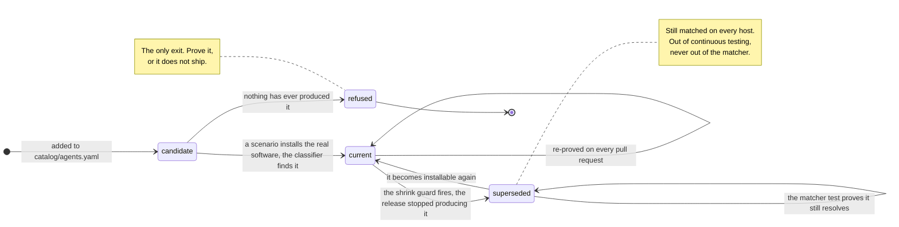

# Signature lifecycle v2 — the north star

**NOTHING HERE IS BUILT.** No code in this repository produces or reads any field, state or
file described below. It is a design record, and it is marked because a vocabulary term with no
producer is the `stale:<n>` mistake — documented in three places, emitted by nobody, and
accepted by a lint check for the whole time. Read `docs/signature-lifecycle-v1.md` for what the
tree actually does.

When this ships, this file describes behaviour and v1 is deleted.

## The rule

**A signature is admitted only if a CI scenario has proved it by a real install — now, or in
the past. There is no third way in.**

| state | what it means | how it is tested |
|---|---|---|
| **current** | the release CI installs today produces this identifier | a scenario, on every pull request |
| **superseded** | a scenario proved it, and the release CI installs today no longer produces it | the matcher test, on every pull request: the value still resolves to its agent |

A superseded signature leaves continuous testing and **stays in the matcher**. Nothing else is
admitted: a value no run has ever produced is not a signature, it is a guess with a comment
beside it, and the two are indistinguishable until something tries to install it.



Two properties the diagram is making explicit. **There is no edge from `candidate` to
`superseded`** — supersession requires a prior observation, so it cannot be reached by typing.
And **`refused` is the only terminal state**: v1's `alias`, `ci-fixture`, `local-only` and
`no-ci-platform` all disappear, because each was a way for a value to persist without a real
install behind it.

## Why `superseded`, and not `retired` or `archived`

The word is load-bearing, because the one thing a reader must not conclude is that these
signatures stop being matched. Industry vocabulary splits along a useful line:

| precedent | word | what it means there |
|---|---|---|
| CPE dictionary | `deprecated`, with a pointer to the replacement | an identifier for a renamed platform, kept because old scan data references it |
| MITRE ATT&CK | `deprecated`, and `revoked` where a specific successor exists | revoked carries the successor; deprecated does not |
| Sigma | `status: deprecated` / `unsupported` | plus a directory that deprecated rules move into |
| npm, PyPI | `deprecated` | still resolvable, still installable, marked |
| RFC, IANA | `Historic` | superseded, kept for the record |
| HTTP | `Deprecation`, then `Sunset` | advice, then an end date |

The common word is **deprecated**; where the point is that a specific newer thing took over, it
is **revoked** or **superseded**. This catalog is the second case, and three things decide it:

1. **It names what was measured.** `retired` and `archived` describe what *we* did.
   `superseded` describes what the *vendor* did — a newer identifier took over. That is the fact
   the record holds.
2. **It is silent about matching.** `archived` means "moved out of the active set" nearly
   everywhere, and `retired` reads as "no longer in service". Both invite the one misreading
   that would break the fleet. A superseded identifier is matched on every host, forever.
3. **`retired` is already taken, for the near-opposite meaning.** On a route in
   `catalog/routes.yaml` it means the route **cannot claim** a row. Reusing it for values that
   match fully would bake that collision in permanently — v1 documents it as the trap most
   likely to cost an afternoon.

`deprecated` is the more recognisable word and was rejected for one reason: it carries *do not
use this*, and here you very much should keep using it.

**`archived` survives, for the other half of the pair.** A *signature* is superseded — it stays
in the matcher and nothing about it moves out of the active set. Its *observation* is archived,
because that genuinely does leave live coverage: the run stops reproducing it and the record is
set aside as history. Two words for two things.

## The record

`superseded:` replaces `retired:` on the agent, as records rather than bare strings. Today's
field says only *this value is old*, which is a claim nothing can check. The record says what
was measured:

```yaml
superseded:
  - {route: bundle_ids, value: com.openai.chat,
     last_version: 1.2026.160, last_proved: 2026-08-20,
     by: 10-desktop-apps, run: 33511815638}
```

Same structure, same place in the file, one concept instead of two. Every field is copied from
the archived observation, and none is typed.

| field | type | what it is |
|---|---|---|
| `route` | route name | which route the value arrived on. Half the key — see below |
| `value` | string | the identifier itself, exactly as it appears on its route list |
| `last_version` | **version string**, not a date | the agent version the row carried the last time a run produced this identifier. `1.2026.160` is a ChatGPT build number, not a year and a day |
| `last_proved` | date, `YYYY-MM-DD` | when that run happened |
| `by` | scenario name | which scenario produced it, so the evidence can be found |
| `run` | CI run id | **the run that last produced the identifier** — not the run that noticed it was gone |

Three of those need saying out loud, because each was ambiguous in an earlier draft of this
design and the ambiguity would have shipped:

**`last_version` is a version, and it was called `last_seen`.** That name reads as a timestamp
in most tooling, and this field holds `1.2026.160` — a build number. Renamed so the type is
legible without reading the schema. Everything the section on version semantics below says
about it still holds: it is a **sighting, not a bound**.

**`last_proved` is stored rather than derived.** A run id can be resolved to a date through the
GitHub API, and an earlier draft said the report would render it that way. That is wrong:
`tools/validate_catalog.py` and `tools/agent_status.py` run inside `test/lint.sh`, offline, on
every pull request, and a page that needs a network call to render a date cannot be generated
there. The transition knows the date at the moment it writes the record, so it writes it.

**`run` names the run that last *proved* it, not the run that lost it.** Those are different
runs, and the useful provenance is the first: it points at the job whose logs and artifacts
show the identifier actually present. It is a GitHub Actions run id, so it resolves to
`https://github.com/<owner>/<repo>/actions/runs/<run>`. The value is copied out of the archived
observation rather than read from the environment, because the losing run is the one holding
the environment variable and it is the wrong run to record.

`run` is the one field an observation does not carry today, and adding it pays twice: it is
also what distinguishes a CI runner from a maintainer's Mac, which is the missing
discrimination v1 names as a gap.

### Tracking several at once

A superseded record is keyed on **`(route, value)`**, the same key coverage credits use and for
the same reason. One agent may carry many, on different routes and with different last
versions, while current values sit beside them on those same route lists:

```yaml
agents:
  - id: openclaw
    name: OpenClaw
    classification: Personal agent
    platforms: [darwin, linux]
    # The route lists are UNCHANGED by supersession. Every value below is still
    # indexed and still matched; `superseded:` only says which of them belong to
    # an earlier release.
    bundle_ids: [ai.openclaw.mac, bot.molt.mac]
    homebrew: [openclaw]
    npm: [openclaw, clawdbot, moltbot]
    state_dirs: ["~/.openclaw"]
    launchd_prefixes: [ai.openclaw., bot.molt.]
    superseded:
      - {route: npm, value: clawdbot, last_version: 2026.1.24-3,
         last_proved: 2026-09-02, by: 56-openclaw-retired-names, run: 33702118455}
      - {route: npm, value: moltbot, last_version: 0.1.0,
         last_proved: 2026-09-02, by: 56-openclaw-retired-names, run: 33702118455}
      - {route: bundle_ids, value: bot.molt.mac, last_version: 2025.11.4,
         last_proved: 2026-06-14, by: 57-openclaw-moltbot-app, run: 32884019773}
      - {route: launchd_prefixes, value: bot.molt., last_version: 2025.11.4,
         last_proved: 2026-06-14, by: 57-openclaw-moltbot-app, run: 32884019773}

  - id: chatgpt-desktop
    name: ChatGPT Desktop
    classification: Desktop assistant
    platforms: [darwin]
    bundle_ids: [com.openai.codex, com.openai.chat]
    homebrew: [chatgpt]
    superseded:
      - {route: bundle_ids, value: com.openai.chat, last_version: 1.2026.160,
         last_proved: 2026-08-20, by: 10-desktop-apps, run: 33511815638}
```

Read what that example is asserting, because several of its properties are load-bearing:

- **Two agents, separate blocks.** Nothing is global. An agent's superseded values live on that
  agent, so a reader answering *what does this catalog say about OpenClaw* reads one entry.
  `tools/validate_catalog.py` already refuses the same `(route, value)` claimed by two agents,
  so a value cannot be superseded for one and current for another.
- **One route, some values superseded and some not.** `npm` carries `openclaw` (current),
  `clawdbot` and `moltbot` (superseded). Supersession is per value, never per route — a whole
  route going quiet is a different failure and stays red.
- **One value, two routes, independently.** OpenClaw ships an npm package *and* a Homebrew cask
  both called `openclaw`. Keying on the value alone would let one supersede the other; keying on
  `(route, value)` is what v1 records as the fix for the same bug in coverage credits, and this
  field inherits it rather than inventing a second rule.
- **Different last versions, and they are not comparable.** `2026.1.24-3`, `0.1.0` and
  `2025.11.4` come from three different products in one lineage. Nothing sorts them, and nothing
  should try to.
- **Two records may share a run.** `clawdbot` and `moltbot` were superseded by the same run, so
  they carry the same `by` and `run`. That is normal: one run can stop producing several
  identifiers at once, and each still gets its own record because each is its own signature.

> The two `bot.molt.` records above are **illustrative, not current**. Nothing has ever proved
> either value, so neither could hold a record like this today — that is exactly what
> [What the rule refuses](#what-the-rule-refuses) is about, and the scenario named in them does
> not exist. They are shown because a lineage with several superseded generations is the case
> this design has to handle, and OpenClaw is the clearest example of one.

On the evidence side, each of those records has a counterpart, and the pair is what makes the
catalog entry checkable:

```json
{
  "scenario": "56-openclaw-retired-names",
  "identifiers": [],
  "archived": [
    {"agent": "openclaw", "route": "npm", "value": "clawdbot",
     "agent_version": "2026.1.24-3", "platform": "darwin", "os": "14.8.9",
     "arch": "arm64", "run": "33702118455", "archived": "2026-09-11"}
  ]
}
```

`last_version` in the catalog is that record's `agent_version`; `run` is its `run`; `by` is the
scenario the file belongs to. A record whose four fields do not line up with an archived
observation is refused.

### Where the evidence lives afterwards

The shrink guard fires precisely when a run stops producing the identifier, and the record step
then replaces that platform's observations — so a design that only wrote the catalog entry
would point `by` and `run` at an observation it had just deleted, and the "checkable" record
would be unverifiable one commit later.

So the observation is **moved, not dropped**: `observed.json` grows an `archived` list beside
`identifiers`, holding the lost record unchanged. That gives each file one job, and the two
check each other:

| file | holds | answers |
|---|---|---|
| `catalog/agents.yaml` | `superseded:` — the signature's status | what the matcher should match and how a finding is labelled |
| `test/scenarios/<name>/observed.json` | `archived` — the observation, moved | what a run actually saw, beside the scenario that saw it |

That split is the repo's existing shape rather than a new one: the catalog claims, the tests
verify, and evidence stays next to the scenario that produced it so a reviewer reads the diff
beside its cause. It is also what lets `tools/validate_catalog.py` check a superseded record by
reading a file, rather than by trusting whoever typed it or digging through git history.

### The value stays on its route

`bundle_ids` keeps `com.openai.chat`; `superseded:` annotates it. This is not tidiness.
`build_index` builds the matcher's index from the route lists, so leaving the value there is
what keeps it matching with **no matcher change at all**. Moving superseded values into a block
of their own would make that block a sixth list which has to agree with the other five, and the
one failure this repo has paid most for is a value present in the catalog, correct, and never
indexed.

## What each file does with it

| file | change |
|---|---|
| `bin/classify` | reads `superseded:` **only to label**. Matching is unchanged by construction. An evidence row carries a flag; a finding whose *every* match is superseded says so in one line, because "this machine is on a build old enough that its identifier changed" is the actionable fact and it is invisible today |
| `test/test_matcher.py` | generates one assertion per superseded value: it still resolves to its agent. This is the live test of a superseded signature |
| `tools/agent_status.py` | one coverage state replacing `alias`, out of both halves of the badge — no live test can cover it, so the numerator would claim a test that does not exist and the denominator would cap the figure for a reason nobody can act on. Named and counted in the report |
| `tools/validate_catalog.py` | keeps today's check that the value is one of the agent's identifiers, which is what guards the section above. Adds: `last_version`, `last_proved`, `by` and `run` must match an archived observation, field for field — a record whose evidence is not in the tree is a guess wearing provenance-shaped fields |

If the labelling in `bin/classify` were ever dropped, the result is silence about generation,
not lost detection. That is the right way round, and it is the reason labelling is the only
thing the matcher gains. The invariant v1 states governs here: **a label on the finding, never a
filter on it.**

**The matcher test is the honest test for a historic signature.** It cannot prove the
identifier is current — nothing can, it is historic — and it does prove the classifier still
finds it, which is the whole of what a superseded record owes the fleet. It is already the
practice for both of today's aliases, hand-written, and `com.openai.chat`'s comment there
reasons its way to exactly this rule for one value: *a real install found it exactly once, that
is not repeatable, so the fixture row is the standing proof.* Generating the assertion from the
block makes that total instead of remembered.

## The other half: finding the successor

Everything above handles the identifier that **left**. A rename has two halves, and the second
one is not designed yet.

When a vendor renames, one run loses an identifier *and* gains a row nothing claims — same
machine, same payload, same agent. `com.openai.chat` did not merely vanish; `com.openai.codex`
arrived in its place, on the same runner, in the same JSON. **That correlation is the strongest
signal this repo could have, and nothing uses it.**

What already exists, and what happens to it:

| piece | state |
|---|---|
| `test/lib/assert.sh` runs `bin/classify --json --show-unmatched` on **every scenario** | the successor row is already computed, on every run |
| an `unmatched_max` assertion exists in that file | **no scenario sets it** — a mechanism with zero users, the same shape as `untested:` |
| `tools/agent_status.py`'s `record()` calls `classify(...)[0]` | findings only. The unmatched list is discarded in the same call that records the findings |

So the new identifier arrives in CI, is computed, is not looked at, and is thrown away. The
old one leaving is caught by three separate guards; the new one arriving is caught by none.

**The design: the guard that reports a loss also reports the candidates.** When the shrink
guard fires, the successor candidates are in the same run's unmatched rows, narrowed two ways:

- **By kind.** A lost `bundle_ids` value means the candidate is an `app` row. The route's kind
  is already in `catalog/routes.yaml`, so this needs no new information.
- **By baseline.** `00-baseline` is a bare machine with `must_find: []` — its unmatched set is
  the runner's noise floor. Subtract it and what remains is what *this scenario's install*
  added. That is a candidate list of a few rows rather than the several hundred an unfiltered
  `--show-unmatched` returns on a real Mac.

The two halves then land in one commit — the superseded record and the successor's signature —
which is what makes a rename reviewable as a single change rather than as a coverage drop
followed, weeks later, by an unexplained addition.

**What this must not do is add a signature.** It proposes candidates; a person confirms the row
is the renamed product by reading what the row points at — a path, an `Info.plist`, a package
name — and adds it under the same real-install standard as any other signature. The difference
from how `bot.molt.mac` got in is that here **the real install already happened**: the candidate
arrives with its evidence attached, from a run that installed the software, rather than from a
vendor's documentation.

The honest limit: an unmatched row is not proof of identity. A scenario installs one agent onto
a machine carrying many other things, and the baseline subtraction removes what was there
before, not what arrived alongside. Narrowing is not deciding.

**No candidate is information too.** If an identifier is lost and nothing unclaimed arrives,
this was not a rename: the route went away. An AppImage replacing a `.deb` leaves no package
record at all, and that reads as a lost `deb_packages` value with no successor anywhere —
which is a different finding, and one the candidate list makes visible by being empty.

## Naming the successor with a model

The narrowing above gets the candidate list down to a few rows. Deciding *which* row is the
renamed product is the step that needs knowledge the rows do not carry: nothing in a payload
says `ai.openclaw.mac` succeeds `bot.molt.mac`. That is what a model is for here, in the daily
run, and it is worth being exact about what it is and is not allowed to do.

### The boundary that decides whether this is safe

Two different things hide under "use a model to find new signatures", and the difference is
**where the identifier string comes from**:

| | what the model does | verdict |
|---|---|---|
| **correlate** | reads the unmatched rows **from the same run** and says which one is the successor | fine. The fact still comes from a real install |
| **recall** | answers *what is OpenClaw's new bundle id* from training data or the web | **this is how `bot.molt.mac` got in.** Refused |

The second is this repo's founding failure with a faster source, and the enforcement is
mechanical rather than a matter of prompt discipline: **the request carries no `web_search` and
no `web_fetch` tool, and no tools at all.** With an empty tool list and the evidence supplied
in the prompt, recall has nowhere to enter from. Every string the model can return is one that
was already in front of it.

### The model chooses; the tooling writes

The model's entire output is **a choice and a reason** — which candidate row is the successor,
with what confidence, and why. It does not emit YAML, a diff, or a patch. Every file in the
resulting pull request is composed by the same code that composes the superseded record, from
rows that are already in the run.

That split is what keeps the blast radius to one decision. A model that writes the diff can
write anything into it; a model that returns `candidates[2]` can only ever be wrong about
*which* real row was chosen — and a reviewer checking one choice against five candidate rows is
doing a job a person can actually do.

**Abstaining is a first-class answer.** The output schema carries `no_candidate` as a valid
result, and the prompt says so. A model forced to choose from a list that contains no successor
will choose confidently and wrongly, which is the failure this repo exists to avoid; when it
abstains, the run opens an issue naming the loss and the candidates it rejected, rather than a
pull request.

### What the pull request contains

A rename is one change and it lands as one reviewable change. The agent was already installed
by an existing scenario — that is how the new row appeared — so a new scenario is usually not
needed. Five files, all derived:

| file | what changes | why |
|---|---|---|
| `catalog/agents.yaml` | the new value added to its route list, and the `superseded:` record for the old one | the two halves of the rename, together |
| `test/fixtures/known-agents.json` | the **actual row from the run**, added verbatim | the interim proof, and a permanent matcher test |
| `test/scenarios/<name>/expected.json` | `must_contain` widened to an alternation carrying both generations | runners disagree during a transition — this is the mechanism v1 documents, applied |
| `test/scenarios/<name>/observed.json` | the lost observation moved into `archived` | the superseded side's evidence |
| the PR body | the lost identifier, its archived observation, every candidate row, the model's choice and reasoning, and the run that produced all of it | what a reviewer needs to disagree |

**It is a pull request, never a commit, and it does not auto-merge.** The daily job runs on
main and has write access; that is exactly why the output is a branch and a PR rather than a
push. A person reviews and merges.

### Why the pull request cannot smuggle in a guess

This is the part worth understanding before trusting the flow, and the answer is that **the
existing gates already refuse it** — no new enforcement is needed:

- A catalog value that no CI test covers fails `--gate` and `--check`. If the model picked a
  row that is not really this agent's, the value still has to be proved by something, and the
  fixture is the only thing standing behind it at review time.
- The fixture row is not synthetic. It is the row the runner actually produced, copied
  verbatim, which is the one kind of fixture this repo grades as real evidence about the
  matcher. After merge, the next main run upgrades the identifier from fixture-proved to
  install-proved on its own.
- The alternation in `must_contain` is deliberately **not** what proves the new value. An
  alternation passes on either generation, so it would go green on the old value alone — that is
  the vacuous-assertion failure this repo has already had once. Coverage is what proves the new
  identifier; the alternation only keeps the cross-runner case from going red during the
  transition.

Measured rather than reasoned. Adding an identifier to `catalog/agents.yaml` with nothing
behind it, then adding the fixture row a successor pull request would carry:

```console
catalog value, no evidence      catalog-gate: FAIL
  chatgpt-desktop: bundle_ids:com.example.successor-probe is tested-absent
  -- no CI test covers it. Cover it, remove it, or record why under `untested:`
+ the fixture row from the run   catalog-gate: ok
```

<!--fixed-number-->
The gate went from refusing that identifier to counting it, and the covered total rose from 54
to 55 — a measurement taken against a temporarily modified tree, not a claim about the tree as
it stands. So the gate refuses a signature with nothing behind it and accepts one carrying a row
a run really produced: exactly the shape of the pull request described above, and exactly not
the shape of a guess.

The residual risk is a wrong choice that the fixture then makes look covered, and there is no
mechanism that catches it — a reviewer does. That is the reason for the PR, and the reason the
body has to carry the rejected candidates rather than only the chosen one.

### Where it runs, and what it must never do

| constraint | why |
|---|---|
| **the `collect` job, main-only, on the daily schedule** | `collect` is already main-only and already the place that aggregates a run. Scenario jobs run on every pull request, so calling from there would spend money per push and widen the secret's scope for nothing |
| **it cannot fail the suite** | a missing key, a rate limit or an API error records the observations and moves on, loudly. An enrichment that fails must never read as *no successor found* |
| **nothing it produces reaches a gated artifact** | `docs/agents.md` is generated and `--check` compares it. Non-determinism in a compared file is a permanently red build |
| **CI payloads only** | runner rows are synthetic and disposable. `bin/classify` is designed to run off-machine over merged fleet payloads, and the same code pointed at one would ship a customer's inventory to an API |
| **what is sent is declared, documented and gate-checked** | the precedent is `docs/telemetry.md`, whose field list `tools/check_doc_numbers.py` fails the build over if it disagrees with `bin/classify`. A second thing that leaves the machine gets the same treatment rather than a new posture |

The inputs are the candidate rows, the lost identifier with its archived observation, and the
agent's other identifiers for context. Bundle ids and image tags are **attacker-choosable
strings** — the catalog says so explicitly of image tags — so they are untrusted input reaching
a prompt. In CI, installing known software on a disposable runner, the exposure is small, and
the mitigations are the ones already listed: no tools, the model returns a choice rather than
text that becomes a diff, and nothing merges without review.

Cost is per rename, not per run: the call happens only when the shrink guard trips.

### Do the cheap half first

The deterministic narrowing — filter by the lost route's kind, subtract the baseline — may well
leave a single candidate, and a single candidate needs no model at all. **Ship the narrowing,
measure how often the list is genuinely ambiguous, and add the model against that measurement.**
That is cheaper to find out than to argue about, and it is the same discipline the rest of this
document applies to identifiers: the number of ambiguous cases is a fact about the tree, and
nobody has counted it yet.

## What the version field can and cannot say

A superseded record keeps the version that last produced the identifier. It is the most useful
field in the record and it is a **sighting, not a bound.** The temptation is to read it as
*version X or below*, and the counterexample is in this catalog:

- `com.openai.chat` was last seen at version `1.2026.160`. Current builds number from `26.` — the
  exact figure moves with every release, and `test/scenarios/10-desktop-apps/observed.json`
  holds whichever one CI last saw. **The version scheme changed at the same rename that
  superseded the identifier**: the app and Codex converged and the numbering went with them. So
  `1.2026.160 or below` cannot be ordered against a current version at all; any comparison
  across that boundary compares two numbering systems.
- Even within one scheme, the interval was never sampled. We saw the identifier present at one
  build and absent at another. The true ceiling is somewhere between, and no run has looked
  there. Recording the sighting as a ceiling rounds an observation into a fact.

So the field is named for what it is — `last_version`, a build number and not a date — and the
rule that follows from it:

> **Say it in prose; never compute on it.** The report may render *last seen at 1.2026.160, so
> a machine reporting this is on that era or older*. Nothing may filter findings by it — a
> consumer gating on `<= X` would silently drop a machine whose scheme differs or whose build
> sits in the unsampled gap, and a filter on findings is the one thing this design cannot have.

## What is deleted

The rule admits two states, both earned by a real install, so every mechanism that existed to
admit a third is removed:

| removed | what it was for |
|---|---|
| `untested:` | a dated reason excusing an identifier no CI test covers |
| `unverified:` | an agent-level exception when no scenario installs the agent at all |
| the `evidence` grades — `vendor-documentation`, `registry-manifest`, `artifact-metadata` | ranking evidence that is *not* a real install |
| the `alias` coverage state | exempting a `retired:` value from the gate. Absorbed by the superseded state |
| `grade()`'s exception branch, and the exception register in `docs/agents.md` | reporting the above |

**Nothing migrates: both registers are absent from the catalog.** Not empty — absent.
`validate_catalog` reports no recorded exceptions and the gate reports no excused identifiers.
The escape hatches were built and never used, and the rule is what the tree has been living by
in practice.

`tools/validate_catalog.py` gets simpler rather than looser: its refusal of an agent with no
scenario stops being conditional on an `unverified` block and becomes unconditional.

**What is not deleted:** the Chromium extension-id derivation. Deleting the `evidence` *enum*
does not touch the fact that a CRX-derived id is stronger evidence than an observation, and v1's
section on it survives into this version unchanged — a derivation is simply another way a real
artifact proves an identifier, not a grade of guess.

## The entry condition

**A signature is superseded when the evidence stops being reproducible — the shrink guard
fires — and never because a passing test became inconvenient.**

This is the line to hold, and it is not academic. `clawdbot` and `moltbot` are proved by a real
install on every pull request today. Choosing to supersede them would trade the strongest
evidence in the tree for a dated record, on the same assumption — *nothing installs them any
more* — that was written down here once and turned out to be false. Superseded must mean
**cannot be proved**, not **is not being proved**; the moment it means the second, it is
`untested:` with better manners.

Two consequences fall out of that condition, and both are deliberate:

- **A scenario leaving the CI matrix is a coverage regression, not a supersession.**
  Supersession requires that the vendor moved on, which is a fact about the software, not a
  scheduling decision. So dropping a scenario while its agent is still current leaves its
  identifiers uncovered and the build stays red. The fourth gap v1 names is closed by ruling the
  case out rather than by accommodating it.
- **An identifier that never appeared stays red.** It cannot be superseded, because supersession
  requires a prior observation. That is the same discriminator as v1's triage table:
  appeared-then-stopped versus never-appeared.

## What the rule refuses

`bot.molt.mac` and `bot.molt.` were never proved by CI, so they do not qualify as superseded
either — the rule requires having been tested. Under it, they must be **proved or removed**, and
removing them plausibly blinds us to a Moltbot-era Mac that carries neither the new bundle id
nor `~/.openclaw`.

The rule is still right, because it converts that from a paperwork problem into a testing
problem. The tree records that whether an old build is still downloadable is UNVERIFIED —
meaning **nobody has checked**. And this repo has already been wrong once about precisely these
values: `56-openclaw-retired-names` exists because *nothing installs them any more* was false
for the npm names. So the action the rule forces is to go looking for a Moltbot-era artifact,
prove the two values if one is fetchable, and supersede them properly. That is strictly better
than a register that let them sit unproved indefinitely.

If someone looks and no artifact is obtainable, *then* they come out, and the loss is recorded
in `docs/blind-spots.yaml` — but only then. That file holds what no amount of test coverage can
move, and "nobody has tried to fetch the old build" is not that. Writing the entry before the
search would file a coverage gap as a platform property, which is how a gap stops being worked
on.

## What this automates, and what it deliberately does not

v1 automates measurement and enforcement end to end and leaves every decision manual. This
version keeps that split exactly and moves one thing across it: the **content** of the
transition, never the decision to make it.

**The transition is prepared automatically and committed by a person**, and it has to be, for
two reasons that are not style:

- **A pull request must not move recorded coverage.** That is `scenarios.yml`'s own rule, and
  it is why the `collect` job is main-only. The shrink guard runs inside each scenario job,
  which runs on every pull request, so the guard is in the one place that cannot write.
- **A vendor pulling a download for a week looks exactly like a rename for that week.** A guard
  that wrote the record and went green would supersede a live signature on the strength of one
  bad afternoon, and the entry condition above exists to stop precisely that.

So the guard keeps failing the job, as it does today, and emits the record it *would* write —
every field derived from the archived observation, none typed. A maintainer confirms the
supersession is real and commits it with a deliberate flag, the same shape `--allow-shrink` has
today. The claim this version makes is **"nothing is typed"**, not "nothing is decided".

| this version adds | why there and not elsewhere |
|---|---|
| moving the lost observation into `observed.json`'s `archived` list instead of replacing it | the shrink guard is the one place that already knows an identifier was proved and is not being reproduced, and this is the step that would otherwise destroy the evidence |
| deriving the superseded record — route, value, `last_version`, `last_proved`, `by`, `run` — from that observation | every field is knowable at that moment and none has to be typed, which is the whole difference between this and `retired:` |
| listing the successor candidates from the same run's unmatched rows | the losing run is also the gaining run, and that correlation exists nowhere else |
| naming which candidate is the successor, in the daily run, with a model | the link from one generation to the next is knowledge the rows do not carry. The model returns a choice, never a diff |
| composing the pull request — catalog, fixture, assertion, archived observation, body | every file is derived from rows already in the run, so none of it has to be written by the model or by a person |
| stamping the run identity onto every observation as it is recorded | the field that makes both the transition and the CI-versus-local distinction possible |
| asserting every superseded value still resolves | generated from the block, so the assertion cannot be forgotten for a value added later |
| refusing a superseded record whose `last_version`/`last_proved`/`by`/`run` matches no archived observation | otherwise the record is a guess with provenance-shaped fields, which is worse than a guess |

| stays manual | why |
|---|---|
| triaging **why** an identifier stopped appearing | five causes, five different actions, and only two are separable from the record alone |
| confirming supersession rather than accepting the first red run | a vendor pulling a download for a week and a rename look identical for that week |
| committing the transition | a pull request must not move recorded coverage, and the guard runs on pull requests |
| confirming a successor candidate **is** the renamed product, by reviewing and merging the pull request | an unmatched row is a row nothing claimed, which is not the same as a row that belongs to this agent — and a wrong choice that a fixture then makes look covered is caught here or not at all |
| widening an assertion to an alternation list | which generations a runner may produce is read off runs, not predicted |
| deciding a signature cannot be proved at all | the rule makes this the one decision that removes a signature, so it should cost a person |
