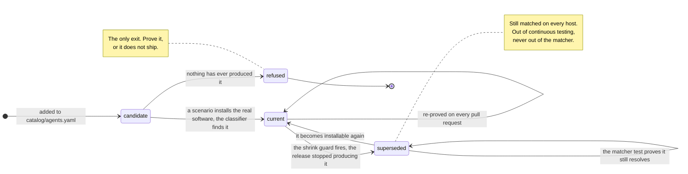

# The signature lifecycle

An identifier is a fact about one build of one product on one machine, and products change
theirs. When a vendor does, the fact does not become false — it stops being **current**.
Machines on the old build still report the old identifier, and they are exactly the machines
an inventory most wants to name.

So the old identifier must keep matching. What has to change is the *claim the tree makes
about it*.

> **On the name.** This file was `-v2` because a `-v1` described the tree as it was before
> this design shipped. Most of it is built now, v1 is deleted, and git history has it. The
> one part still unbuilt is marked where it begins, and nowhere else.

This repo has been bitten three times, and the third is why the rest of this document exists:

- **An OpenClaw bundle id taken from a Homebrew zap stanza** was carried for months as an
  identifier "machines on the earlier release still report". No such release was ever
  published: read off the project's own assets, 243 releases deep, the macOS app shipped as
  **Clawdis** → **Clawdbot** (`com.clawdbot.mac`) → **OpenClaw** (`ai.openclaw.mac`). The
  comment directly above it already said a zap stanza is how the wrong one gets shipped.
- **`aider`** installs as `aider-chat` under `uv` and `pipx` while its state directory is
  `~/.aider`, so evidence and signature never met.
- **npm `mcp`** is Mintlify's package and npm **`aider`** is a static-site component by an
  unrelated maintainer. Each sat beside a comment explaining the discrepancy rather than
  questioning it, which is how a guess survives review.

All were silent. None was caught by reading the catalog.

## The rule

**A signature is admitted only if a CI scenario has proved it by a real install — now, or in
the past. There is no third way in.**

| state | what it means | how it is tested |
|---|---|---|
| **current** | the release CI installs today produces this identifier | a scenario, on every pull request |
| **superseded** | a scenario proved it, and the release CI installs today no longer produces it | the matcher test, on every pull request: the value still resolves to its agent |

A superseded signature leaves continuous testing and **stays in the matcher**. Nothing else is
admitted: a value no run has ever produced is not a signature, it is a guess with a comment
beside it, and the two are indistinguishable until something tries to install it.



Two properties the diagram makes explicit. **There is no edge from `candidate` to
`superseded`** — supersession requires a prior observation, so it cannot be reached by
typing. And **`refused` is the only terminal state**.

## Why `superseded`, and not `retired` or `archived`

The word is load-bearing, because the one thing a reader must not conclude is that these
signatures stop being matched. `deprecated` is the industry word — CPE, ATT&CK, Sigma, npm —
and carries *do not use this*; here you very much should keep using it. `retired` and
`archived` describe what *we* did rather than what the *vendor* did, both read as "out of
service", and `retired` already means the near-opposite on a route in `catalog/routes.yaml`:
the route **cannot claim** a row. `superseded` names what was measured and is silent about
matching.

**`archived` survives, for the other half of the pair.** A *signature* is superseded — it stays
in the matcher. Its *observation* is archived, because that genuinely does leave live coverage.
Two words for two things.

---

# Part one: how a signature is proved

## A real install is the bar

A signature is verified when a CI scenario installs the real software and asserts the
classifier finds it. Coverage is counted **per identifier** — an agent can pass while carrying
an identifier nothing exercised — and only from scenarios in the `scenarios.yml` matrix, which
runs on every pull request. `tools/agent_status.py --check` fails the build below complete, so
there is no partial state to manage.

`tools/validate_catalog.py` refuses an agent no scenario installs, **unconditionally**. There
is no block that buys an exception; see [what was deleted](#what-was-deleted-and-why).

## Where the proof is recorded

Each run records what it actually matched in `test/scenarios/<name>/observed.json`, beside the
scenario that wrote it, so a run changes one file and a reviewer reads the diff next to its
cause. A record carries the agent version, platform, OS, arch — and the **run** that produced
it.

That last field is what lets proof outlive the run. Without it an observation from a CI runner
and one from a maintainer's Mac are the same record, so *this identifier was once proved by CI*
becomes unanswerable the moment CI stops reproducing it — which is the whole basis of a
superseded record. It is absent off CI deliberately: a local run has no run to name, and
inventing one would manufacture exactly the provenance the field exists to carry.

The field sits **outside the merge key**. Two runs on the same `(platform, os, arch)` are one
observation re-proved, not two.

## Fixtures prove the matcher, not the identifier

`test/fixtures/*.json` is hand-written. Nothing on a row distinguishes a captured one from
one somebody typed, so while fixtures credited coverage, a typed string was evidence.

So nothing replays a fixture into coverage. **Coverage comes from observations only** — what
a run recorded, with the run named on the record.

A `captured/` directory stood here briefly, holding rows attributable to a named CI run so
those alone could credit coverage. Nothing ever wrote it. It was a reader for a producer that
did not exist, which is the shape this repo refuses everywhere else, and the gate's
`--pending-ok` split removed the case it was built for: a signature now lands **pending** on
the pull request that adds it, and the coverage job after the matrix decides whether it
appeared. That is a better answer than an interim fixture, because it is the run itself
speaking rather than a row copied out of one.

## One route grades stronger than observation

A Chromium extension id is not assigned, it is **derived**: SHA-256 over the developer's DER
public key, first 16 bytes, hex mapped `0-f` to `a-p`. The Web Store's signed CRX carries that
key, so the id can be recomputed from the publisher's own signed artifact rather than observed
on a machine.

An observation says one machine reported an id once; a derivation says the id belongs to that
signing key and could not belong to anyone else's. It also explains exactly why a planted or
unpacked extension reports an **empty** identifier — no key, nothing to derive from.

Most routes offer nothing like it. A bundle id is a string in a plist anyone can write, an
image tag is chosen by whoever ran `docker tag`, and a Homebrew token is a name in a
repository. For those, a real install remains the bar.

## Two things only a real run exposed

**Credits are keyed by `(route, value)`, never by value alone.** OpenClaw ships an npm package
*and* a Homebrew cask both called `openclaw`, so a value-keyed credit let an npm-only scenario
record the Homebrew token as observed. The same keying is why a `superseded:` record names its
route.

**Coverage counts against CI, not against "has anyone run this".** A scenario passing only on a
maintainer's machine catches nothing on a pull request, and one sat in exactly that state:
passing locally, absent from the matrix, indistinguishable from covered.

---

# Part two: several generations at once

Nothing special happens for an older generation. It is an ordinary catalog value, indexed and
matched exactly like the current one. Three layers carry the version spread:

| layer | how it holds several generations | read it in |
|---|---|---|
| **catalog** | every generation is a normal value on its route; `superseded:` marks the ones a run stopped producing | `catalog/agents.yaml` |
| **assertion** | a `must_contain` entry may be a **list**, meaning *any of these satisfies the probe* | `test/lib/assert.sh` |
| **coverage** | credit is keyed `(route, value)` and recorded per `(platform, os, arch)` with the version that produced it | `tools/agent_status.py` |

The alternation was not a design, it was a **measurement**. One run installed the same
`chatgpt` cask on two runner images and got two builds — a current one reporting
`com.openai.codex`, and one whose Homebrew metadata was stale enough to still resolve the
pre-rename release, reporting `com.openai.chat`. A single-value probe would have gone red on
one runner and named the wrong cause.

**What the coexistence costs.** On the exact-match routes, an extra generation is one more dict
entry and no extra comparison. On the prefix and path routes it is one more comparison per
candidate row. That is the ceiling worth watching if a lineage grows long, and it is a property
of the route, not of the value being old.

## What the version field can and cannot say

A superseded record keeps `last_version` — the version that last produced the identifier. It is
the most useful field in the record and it is a **sighting, not a bound.** The temptation is to
read it as *version X or below*, and the counterexample is in this catalog:

- `com.openai.chat` was last seen at version `1.2026.160`. Current builds number from `26.` —
  **the version scheme changed at the same rename that superseded the identifier**. So
  `1.2026.160 or below` cannot be ordered against a current version at all; any comparison
  across that boundary compares two numbering systems.
- Even within one scheme, the interval was never sampled. We saw the identifier present at one
  build and absent at another. The true ceiling is somewhere between, and no run has looked
  there. Recording the sighting as a ceiling rounds an observation into a fact.

> **Say it in prose; never compute on it.** The report may render *last seen at 1.2026.160, so
> a machine reporting this is on that era or older*. Nothing may filter findings by it — a
> consumer gating on `<= X` would silently drop a machine whose scheme differs or whose build
> sits in the unsampled gap, and a filter on findings is the one thing this design cannot have.

---

# Part three: when a signature drifts

## What tells you

Three things fire, at different moments. All three run on every pull request.

| trigger | when it fires | where |
|---|---|---|
| **the shrink guard** | a run proves *fewer* identifiers than the committed record. Refuses to record and names each loss | `tools/agent_status.py`, in `record()` |
| **`tested-absent`** | a CI scenario asserts this agent and this identifier never showed up. `--check` fails the build | `tools/agent_status.py`, in `collect()` |
| **an assertion** | `must_contain` names the value and the row is gone. Fires *before* recording | `test/lib/assert.sh` |

An assertion failure means the value was named explicitly by a scenario; the shrink guard means
it was only being counted. A value under an alternation list fires neither until the *last*
alternative goes.

## Triage: why did it stop appearing

`did not appear` is the state that does the most work. It means one of five things, and telling
them apart is the job:

| it means | how you tell | what to do |
|---|---|---|
| the scenario installs by another route | another route's value appeared in the same run | install that route — on **another machine**, because two routes claiming one binary name cannot share a host |
| the artifact only exists once the agent **runs** | it is a `state_dirs` value and the scenario only installed | invoke the agent. A state directory is not created by installing |
| the identifier is **wrong** | **it has never appeared in any committed observation** | remove it. Both catalog bugs found so far were this |
| the route cannot identify at all | it only ever matched when something else had already named the agent | remove the route. `ports` went for this |
| **the identifier is right and is no longer installable** | **it appeared in a committed observation before, and does not now** | supersede it. The value stays; continuous testing stops |

The discriminator between the third row and the last is one command, and it is the whole
triage:

```console
$ grep -rl '"value": "<the value>"' test/scenarios/*/observed.json
```

A value some run once produced is a fact with provenance behind it. A value nothing has ever
produced is a guess.

## The transition

`--supersede` on the recording step **moves** the lost observation into an `archived` list in
the same `observed.json`, keeps the live list to what the run actually proved, and prints the
catalog block to paste. `--allow-shrink` keeps its old meaning: *the artifact was stale, forget
it*.

It is **deliberate, never automatic**. At the moment the guard fires, a vendor pulling a
download for a week and a rename are the same event: one run, one absence. A guard that
archived on its own would supersede a live signature on one bad afternoon.

**They are distinguishable over time, and the record now carries what that needs.** Every
observation names the run that produced it and the date it was proved, so "absent across N
consecutive runs spanning M days" is computable from the tree. That does not automate the
decision and should not — but it turns a coin-flip into evidence, and it is the obvious next
thing to build here. What is missing is not data, only the arithmetic over it.

Two drop sites had to be handled, not one — the guard, and the per-platform merge, which
discards same-key records before the guard runs. A third lived in the collect job: its merge
rebuilt the document from scratch and would have **erased the archive on every run**, and its
union with the per-platform copy would have **resurrected** archived records from another
runner's upload. That merge is `tools/merge_observations.py` now, extracted from a YAML heredoc
precisely so those two could be asserted.

## Proving an old identifier

There is no register to put an unproved value in. If you want a signature, you prove it.

Do not conclude that an older generation is untestable. That conclusion has been reached
three times and was wrong every time. OpenClaw's retired npm names were recorded as coverable
only by a fixture on the reasoning that nothing installs them any more; both packages turned
out to be still published, and `56-openclaw-retired-names` installs them for real. The
predecessor macOS app was assumed gone; the release asset is still downloadable, and
`57-clawdbot-era` installs it. And once the `chatgpt` cask stopped resolving the pre-rename
build, `com.openai.chat` looked ready to supersede; OpenAI still serves that DMG, and
`12-chatgpt-pre-rename` installs it.

Two things those scenarios had to get right, and both generalise:

- **The old generation usually cannot share a host with the current one.** All three OpenClaw
  npm packages provide the same global binary, so one would mask another. Testing a lineage
  means one scenario per generation.
- **They install deliberately outdated software**, which is safe only because the guest is
  disposable, unenrolled and holds no credentials. That warning belongs in the setup script,
  where someone reads it before running it — not in `expected.json`, where it is rendered into
  a coverage report nobody consults first.

---

# Part four: the record

`superseded:` sits on the agent, as records rather than bare strings:

```yaml
superseded:
  - {route: bundle_ids, value: com.openai.chat,
     last_version: 1.2026.160, last_proved: 2026-08-20,
     by: 10-desktop-apps, run: 33511815638}
```

| field | type | what it is |
|---|---|---|
| `route` | route name | which route the value arrived on. Half the key |
| `value` | string | the identifier, exactly as it appears on its route list |
| `last_version` | **version string**, not a date | the agent version the row carried the last time a run produced it. `1.2026.160` is a build number |
| `last_proved` | date, `YYYY-MM-DD` | when that run happened |
| `by` | scenario name | which scenario produced it |
| `run` | CI run id | **the run that last produced the identifier** — not the run that noticed it was gone |

`run` names the run that last *proved* it. Those are different runs, and the useful provenance
is the first: it points at the job whose logs show the identifier present. It is copied out of
the archived observation rather than read from the environment, because the losing run holds
the environment variable and is the wrong run to record.

`last_proved` is **stored rather than derived**. A run id resolves to a date through the GitHub
API, and `validate_catalog.py` and `agent_status.py` run inside `test/lint.sh`, offline, on
every pull request — a page that needs a network call to render a date cannot be generated
there.

## Where the evidence lives

The transition is the step that would otherwise destroy it, so the observation is **moved, not
dropped**. Each file has one job, and the two check each other:

| file | holds | answers |
|---|---|---|
| `catalog/agents.yaml` | `superseded:` — the signature's status | what the matcher matches, and how a finding is labelled |
| `test/scenarios/<name>/observed.json` | `archived` — the observation, moved | what a run actually saw, beside the scenario that saw it |

`validate_catalog.py` compares them field for field: `last_version`, `by` and `run` must match
an archived observation, or the record is refused. A record whose evidence is not in the tree is
a guess wearing provenance-shaped fields, which is worse than a guess because it reads as
evidence.

## The value stays on its route

`bundle_ids` keeps `com.openai.chat`; `superseded:` annotates it. This is not tidiness.
`build_index` builds the matcher's index from the route lists, so leaving the value there is
what keeps it matching with **no matcher change at all**. The validator enforces it: a
superseded value taken off its route is refused.

## Tracking several at once

A record is keyed on **`(route, value)`**. One agent may carry many, on different routes and
with different last versions, while current values sit beside them on those same lists:

```yaml
  - id: some-agent
    bundle_ids: [com.vendor.current, com.vendor.old]
    npm: [vendor-cli, vendor-cli-legacy]
    superseded:
      - {route: bundle_ids, value: com.vendor.old, last_version: 3.1.0,
         last_proved: 2026-06-14, by: 41-vendor-era, run: 32884019773}
      - {route: npm, value: vendor-cli-legacy, last_version: 0.9.2,
         last_proved: 2026-06-14, by: 41-vendor-era, run: 32884019773}
```

- **One route, mixed states.** `npm` carries a current value and a superseded one.
- **One value, two routes, independently.** Keying on the value alone would let one supersede
  the other — the same lesson as the coverage credits.
- **Different last versions are not comparable.** Nothing sorts them, and nothing should try.
- **Two records may share a run.** One run can stop producing several identifiers at once.

## What each file does with it

| file | behaviour |
|---|---|
| `bin/classify` | reads `superseded:` **only to label**. An evidence row is flagged; a finding whose *every* match is superseded says so in one line |
| `test/test_matcher.py` | asserts a superseded match is still a finding, both generations are still evidence, and the right one is named |
| `tools/agent_status.py` | a `superseded` coverage state, out of **both** halves of the badge — no live test can cover it |
| `tools/validate_catalog.py` | route exists, value still on it, date is a date, and the archived observation matches |

```
npm     moltbot  0.1.0   <- earlier release
        /x
Every identifier that matched belongs to an earlier release. This machine has not updated.
```

**A label, never a filter.** A superseded identifier exists for the machines nothing else will
match, so a label that withheld the finding would produce an empty result on exactly the fleet
the record was kept for — the error this repo is built to refuse, wearing a new name. If the
labelling were ever dropped the result is silence about generation, not lost detection, and
that is the right way round.

---

# What was deleted, and why

The rule admits two states, both earned by a real install, so every mechanism that existed to
admit a third is gone:

| removed | what it was for |
|---|---|
| `untested:` | a dated reason excusing an identifier no CI test covers |
| `unverified:` | an agent-level exception when no scenario installs the agent |
| the `evidence` grades — `vendor-documentation`, `registry-manifest`, `artifact-metadata` | ranking evidence that is *not* a real install |
| the `alias` state and the `retired:` list | exempting a hand-typed value from the gate |
| `grade()` and the exception register | reporting the above |

**Nothing migrated: both registers held zero entries for their entire lives**, while remaining
the only ways in that did not require a machine to have run the software. The weakest grade
`unverified:` accepted was `vendor-documentation` — the source this repo exists to distrust.
The Chromium extension-id derivation above stays: a CRX-derived id is stronger than an
observation whether or not an `evidence` enum says so.

## The entry condition

**A signature is superseded when the evidence stops being reproducible — the shrink guard
fires — and never because a passing test became inconvenient.**

`clawdbot` and `moltbot` are proved by a real install on every pull request. Choosing to
supersede them would trade the strongest evidence in the tree for a dated record, on the same
assumption — *nothing installs them any more* — that was written down here once and turned out
to be false. Superseded must mean **cannot be proved**, not **is not being proved**.

Two consequences, both deliberate:

- **A scenario leaving the CI matrix is a coverage regression, not a supersession.**
  Supersession requires that the vendor moved on, which is a fact about the software, not a
  scheduling decision.
- **An identifier that never appeared stays red.** It cannot be superseded, because
  supersession requires a prior observation.

And a third the tree has already exercised: **an identifier that was never real is removed,
not superseded.** Supersession is for a value a run once produced. Two OpenClaw values had no
observation anywhere — no fixture, no scenario, no run — so neither qualified for it, and both
were deleted outright.

---

# The other half of a rename: what arrived

Everything above handles the identifier that **left**. A rename has two halves, and until
recently only one was watched.

When a vendor renames, one run loses an identifier *and* gains a row nothing claims — same
machine, same payload, same agent. `com.openai.chat` did not merely vanish;
`com.openai.codex` arrived in its place, on the same runner, in the same JSON. **That
correlation is the strongest signal this repo has**, and it was being computed and thrown
away: `test/lib/assert.sh` runs `bin/classify --json --show-unmatched` on every scenario,
an `unmatched_max` assertion exists that no scenario sets, and `replay()` keeps findings
while discarding the unmatched list in the same call.

**The shrink guard now reports both halves.** When it refuses a run, it names the loss and
then the rows that arrived unclaimed, narrowed two ways — neither of them clever:

- **By kind.** A lost `bundle_ids` value means the successor is an `app` row, and
  `catalog/routes.yaml` already says which kind a route arrives on. Nothing is typed.
- **By baseline.** `tools/successor_candidates.py --baseline` subtracts a bare machine's
  unmatched set, which is the runner's own furniture rather than anything a scenario
  installed. That turns several hundred rows into a few.

```
Lost: bundle_ids:com.openai.chat
  2 unclaimed row(s) of that kind arrived in the same run. A successor, if there is
  one, is among them:
    app       com.vendor.brandnew  2.0.0
              /Applications/BrandNew.app
  Confirm one is the renamed product before cataloguing it: an unclaimed row is not
  the same as this agent's row.
```

The guard has only its own scenario's payload, so the baseline subtraction is available to
the standalone tool rather than applied automatically — which is why furniture can still
appear in that list. The enrichment is wrapped: if it fails for any reason it says so and
the refusal still prints. The loss is the finding; candidates are a convenience, and a
convenience that turns a clear failure into a traceback has made things worse.

**What this is not.** It proposes candidates; it does not identify anything. An unmatched
row is a row nothing claimed, which is not the same as a row belonging to the agent that
just lost an identifier — a scenario installs one agent onto a machine carrying many other
things. Narrowing is not deciding, and a candidate becomes a signature the way every other
one does: a scenario installs the software and a run produces the row.

**An empty list is information.** If an identifier is lost and nothing unclaimed arrives,
this was not a rename — the route went away. An AppImage replacing a `.deb` leaves no
package record at all.

---

# NOT BUILT: naming the successor with a model

**Everything above this line is implemented. Nothing below it is.** It is a design record,
and it is marked because a vocabulary term with no producer is the `stale:<n>` mistake —
documented in three places, emitted by nobody, and accepted by a lint check the whole time.

Deciding *which* candidate is the renamed product needs knowledge the rows do not carry:
nothing in a payload says `ai.openclaw.mac` succeeds `com.clawdbot.mac`.

**The boundary that decides whether this is safe** is where the identifier string comes from:

| | what the model does | verdict |
|---|---|---|
| **correlate** | reads the unmatched rows **from the same run** and says which is the successor | fine. The fact still comes from a real install |
| **recall** | answers *what is the new bundle id* from training data or the web | **this is how a wrong identifier gets in.** Refused |

Enforcement is mechanical rather than prompt discipline: **the request carries no tools at
all**, so with the evidence supplied in the prompt, recall has nowhere to enter from.

**The model chooses; the tooling writes.** Its entire output is a choice and a reason — never
YAML, a diff or a patch. A model that writes the diff can write anything into it; one that
returns a candidate index can only be wrong about which real row was chosen. **Abstaining is a
first-class answer**, because a model forced to choose from a list with no successor in it will
choose confidently and wrongly.

The result is a **pull request, never a commit** — the daily job runs on main with write
access, which is exactly why. It carries the catalog edit, the captured fixture row, the
widened assertion, the archived observation, and a body naming the rejected candidates. It
cannot smuggle in a guess: the gates above already refuse a signature nothing produced, and the
fixture row it carries is one a run really produced.

**Do the cheap half first.** The deterministic narrowing may leave a single candidate, and a
single candidate needs no model. Ship the narrowing, measure how often the list is genuinely
ambiguous, and add the model against that measurement.

---

# How much is automated

| automated | where |
|---|---|
| recording what each run matched, per identifier, with version, platform, OS, arch and run id | `--record`, in every scenario job |
| merging one scenario's observations across every runner, carrying the archive | `tools/merge_observations.py`, main-only |
| regenerating `docs/agents.md`, `docs/limits.md` and the README badge | `--write`, plus `docs.yml` as a safety net |
| computing coverage per identifier and per platform, against the CI matrix | `tools/agent_status.py` |
| refusing a run that proves less than the committed record | the shrink guard |
| listing what arrived unclaimed when a run loses an identifier | `tools/successor_candidates.py`, called by the guard |
| moving a lost observation into `archived` and printing the catalog record | `--supersede` |
| failing the build on an identifier no CI test covers | `--gate` and `--check` |
| refusing a superseded record whose archived observation is missing or does not match | `tools/validate_catalog.py` |
| refusing a cited document that does not exist | `tools/check_doc_numbers.py` |

| stays manual | why |
|---|---|
| triaging **why** an identifier stopped appearing | five causes, five actions, and only two are separable from the record alone |
| confirming a candidate **is** the renamed product | an unclaimed row is a row nothing claimed, which is not the same as this agent's row |
| deciding to supersede, rather than accepting the first red run | a week-long outage and a rename look identical for that week |
| widening an assertion to an alternation list | which generations a runner may produce is read off runs, not predicted |
| deciding a signature cannot be proved at all | the one decision that removes a signature, so it should cost a person |
