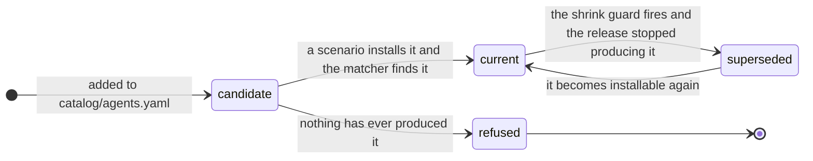

# The identifier lifecycle

An identifier is a fact about one build of one product, and products change theirs. When a
vendor does, the fact does not become false; it stops being **current**. Machines on the old
build still report the old identifier, and they are the machines an inventory most wants to
name. So the old identifier keeps matching. Only the tree's claim about it changes.

[SPEC.md §7](../SPEC.md#7-provenance) defines the two statuses. This page is how this
repository runs them.

## The rule

**An identifier is admitted only if a CI scenario has proved it by a real install, now or in
the past.**

| status | means | tested by |
|---|---|---|
| **current** | the release CI installs today produces it | a scenario, weekly and on every pull request that can move it |
| **superseded** | a scenario proved it, and today's release no longer produces it | `test/test_matcher.py`: the value still resolves to its agent |

A superseded identifier leaves continuous testing and **stays in the matcher**. A value no run
has ever produced is a guess, and is refused.



There is no edge from `candidate` to `superseded`: supersession needs a prior observation, so
it cannot be typed.

**Why "superseded".** `deprecated` says *do not use this*, and these must keep matching.
`retired` already means the opposite on a route in `catalog/routes.yaml`: the route claims
nothing. The *observation* behind a superseded identifier is **archived**, because that one
does leave live coverage.

## How an identifier is proved

`tools/validate_catalog.py` refuses an agent no scenario installs, and
`tools/agent_status.py --check` fails the build on an identifier no CI scenario produced.
Coverage is counted per identifier, because an agent can pass while carrying one nothing
exercised, and only from scenarios in the `scenarios.yml` matrix: a scenario that passes only on
a maintainer's machine catches nothing on a pull request.

**Proof is recorded beside the scenario**, in `test/scenarios/<name>/observed.json`: agent
version, platform, OS, arch, and the CI **run** that produced it. The run is what lets proof
outlive it. Off CI the field is absent, because a local run has no run to name. It is outside
the merge key, so two runs on one `(platform, os, arch)` are one observation re-proved.

**Credit is keyed by `(route, value)`, never by value alone.** OpenClaw ships an npm package
and a Homebrew cask both named `openclaw`, and a value-keyed credit let an npm-only scenario
record the cask as observed.

**Fixtures prove the matcher, not the identifier.** Nothing on a row tells a captured one from
a typed one, so coverage comes only from observations. A pull request that adds an identifier
lands it **pending**, and the coverage job after the matrix decides whether it appeared.

**A Chromium extension id is derived, not assigned**: SHA-256 over the publisher's public key,
first 16 bytes, hex mapped `0-f` to `a-p`. The Web Store's signed CRX carries the key, so the
id can be recomputed from the publisher's own artifact, which is stronger than one machine
reporting it. It is also why an unpacked extension reports an empty id: no key.

## Several generations at once

An older generation is an ordinary catalog value, matched like the current one.

| layer | how it holds several generations | in |
|---|---|---|
| catalog | each generation is a value on its route; `superseded:` marks the ones a run stopped producing | `catalog/agents.yaml` |
| assertion | a `must_contain` entry may be a **list**: any of these satisfies the probe | `test/lib/assert.sh` |
| coverage | credit keyed `(route, value)`, recorded per `(platform, os, arch)` with its version | `tools/agent_status.py` |

The list form was measured, not designed: one run installed the `chatgpt` cask on two runner
images and got `com.openai.codex` on one and the pre-rename `com.openai.chat` on the other.

**`last_version` is a sighting, not a bound.** `com.openai.chat`'s last build is `1.2026.160`,
and its successor numbers from `26.`: the scheme changed at the rename, so the two cannot be
ordered. Even within one scheme the interval between present and absent was never sampled.
Render it in prose; never filter findings by it.

## When an identifier stops appearing

| trigger | fires when | where |
|---|---|---|
| the shrink guard | a run proves fewer identifiers than the committed record; it refuses to record and names each loss | `tools/agent_status.py`, `record()` |
| `tested-absent` | a CI scenario installed the agent and this identifier never showed up; `--check` fails | `tools/agent_status.py`, `collect()` |
| an assertion | `must_contain` names the value and the row is gone | `test/lib/assert.sh` |

A value under an alternation list fires none of them until its last alternative goes.

## Triage: why did it stop appearing

| it means | how you tell | what to do |
|---|---|---|
| the scenario installs by another route | another route's value appeared in the same run | install that route on **another machine**: two routes claiming one binary name cannot share a host |
| the artifact exists only once the agent **runs** | a `state_dirs` value, and the scenario only installed | invoke the agent |
| the identifier is **wrong** | **no committed observation has ever held it** | remove it. npm `mcp` (Mintlify's) and npm `aider` (a static-site component) were this |
| the route cannot identify at all | it only matched when something else had already named the agent | remove the route; `ports` went for this |
| **it is right and no longer installable** | **a committed observation held it, and none does now** | supersede it |

The third and fifth rows look identical in the report and take opposite actions. One command
tells them apart:

```console
$ grep -rl '"value": "<the value>"' test/scenarios/*/observed.json
```

**Be slow to conclude a generation is uninstallable.** It was concluded three times and was
wrong each time: OpenClaw's old npm names are still published (`56-openclaw-retired-names`),
the Clawdbot app is still downloadable (`57-clawdbot-era`), and OpenAI still serves the
pre-rename ChatGPT DMG (`12-chatgpt-pre-rename`). Two lessons generalise: an old generation
usually cannot share a host with the current one, so test one generation per scenario; and
installing deliberately outdated software is safe only in a disposable guest, which the setup
script says where its reader will see it.

## Superseding

```console
$ python3 tools/agent_status.py --record /tmp/out.json test/scenarios/<scenario> --supersede
```

This **moves** the lost observation into the `archived` list of that `observed.json` and
prints the record to paste under the agent:

```yaml
superseded:
  - {route: bundle_ids, value: com.example.old, last_version: 1.4.2,
     last_proved: 2026-09-14, by: 57-example-era, run: 34840592589}
```

| field | what it is |
|---|---|
| `route`, `value` | the key. One agent may carry several records, on different routes, beside current values on the same lists |
| `last_version` | the agent version the row carried the last time a run produced it |
| `last_proved` | that run's date, stored because rendering it from the run id would need the network, and lint runs offline |
| `by`, `run` | the scenario and the CI run that **last produced** it, copied from the archived observation, not the run that noticed it was gone |

- **Deliberate, never automatic.** For a week, a vendor pulling a download and a rename are the
  same absence. Every observation carries its run and date, so "absent across N runs over M
  days" is computable from the tree; nothing computes it yet.
- **The value stays on its route.** The matcher's index is built from the route lists, so
  leaving it there keeps it matching with no matcher change. `tools/validate_catalog.py` refuses
  a superseded value taken off its route.
- **The provenance cannot be typed.** `tools/validate_catalog.py` refuses a record whose
  `last_version`, `by` and `run` no archived observation matches.
- **A label, never a filter.** `bin/classify` marks each evidence row a superseded identifier
  matched, and a finding whose every match is superseded says the machine has not updated.
  Withholding that finding would return an empty result on exactly the fleet the record was
  kept for. `tools/agent_status.py` reports it as `superseded`, outside both halves of the
  coverage badge.
- `tools/merge_observations.py` carries the archive through the collect job's merge, which once
  rebuilt the document from scratch and would have erased it.

**Superseded means cannot be proved, not is not being proved.** A scenario leaving the CI
matrix is a coverage regression. An identifier that never appeared cannot be superseded, only
removed.

## What was deleted, and why

The rule admits two statuses, both earned by a real install, so everything that admitted a
third is gone. None of it ever held an entry.

| removed | what it was for |
|---|---|
| `untested:` | a dated excuse for an identifier no CI test covers |
| `unverified:` and its `evidence` grades, down to `vendor-documentation` | an agent-level exception when no scenario installs it |
| the `alias` state and the `retired:` list | exempting a typed value from the gate |

## The other half of a rename

A rename loses an identifier and, in the same run, gains a row nothing claims:
`com.openai.codex` arrived where `com.openai.chat` left. So when the shrink guard refuses a run,
it also lists the rows that arrived unclaimed, narrowed by **kind** (a lost `bundle_ids` value
means an `app` successor, per `catalog/routes.yaml`) and, in
`tools/successor_candidates.py --baseline`, by subtracting a bare machine's unmatched rows.

```
Lost: bundle_ids:com.openai.chat
  2 unclaimed row(s) of that kind arrived in the same run. A successor, if there is
  one, is among them:
    app       com.vendor.brandnew  2.0.0
              /Applications/BrandNew.app
```

It proposes; it does not identify. A candidate becomes an identifier like any other: a scenario
installs the software and a run produces the row. An empty list means the route went away
rather than renamed, as when an AppImage replaces a `.deb`. If listing candidates fails, the
refusal still prints.

---

# NOT BUILT: naming the successor with a model

**Everything above this line is implemented. Nothing below it is.**

Deciding which candidate is the renamed product needs knowledge the rows do not carry. A model
may **correlate**, choosing among unmatched rows from the same run, because the fact still
comes from a real install. It may never **recall** an identifier from training data or the web,
which is how a wrong one gets in. So:

- the request carries no tools, and the evidence is in the prompt;
- the model returns a choice and a reason, never YAML or a diff, and abstaining is a valid
  answer;
- the result is a pull request, never a commit, and the gates above still refuse an identifier
  no run produced.

Build the deterministic narrowing first and measure how often it leaves more than one
candidate; a single candidate needs no model.

## What stays manual

| | why |
|---|---|
| triaging why an identifier stopped appearing | five causes, and only two are separable from the record |
| confirming a candidate is the renamed product | a row nothing claims is not the same as this agent's row |
| deciding to supersede | a week-long outage and a rename look identical for that week |
| widening an assertion to a list | which generations a runner produces is read off runs |
| deciding an identifier cannot be proved | it removes an identifier, so it should cost a person |
